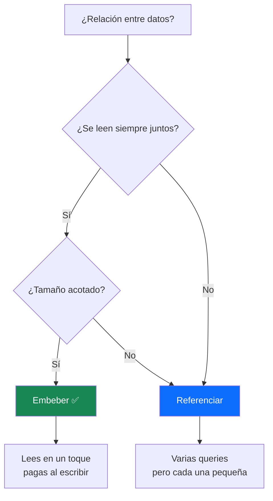

No sé cuándo fue la última vez que añadiste una columna a una tabla. Sí me acuerdo de la sensación: `ALTER TABLE`, un café mientras corre el proceso, y la oración corta que se le dice al dios de las copias de seguridad.

Y eso si la tabla estaba vacía. Si tenía doscientos millones de filas, esa misma operación podía dejarte el servidor ocupado la tarde entera.

Hay un patrón que he visto repetirse en casi todos los modelos de datos que he mirado: el primer esquema se dibuja el primer día, con una demo delante y sin saber muy bien qué preguntas hará después. Luego los datos crecen, las necesidades cambian, y el esquema sigue ahí, fingiendo que el mundo no se mueve.

Hay bases de datos que no te condenan a esa decisión de por vida. Y una de ellas nació, literalmente, para guardar JSON.

Ahí es donde entra MongoDB.

<!-- more -->

## ¿Qué es MongoDB?

MongoDB guarda **documentos**. No filas con columnas fijas: documentos. Cada documento es un objeto con sus campos, sus anidamientos y sus listas, y dos documentos de la misma colección no tienen por qué tener exactamente la misma forma.

Eso suena a herejía si vienes de SQL, y en realidad es lo contrario: es el modelo de datos con el que ya piensas en tu código. Tu objeto de producto ya tiene una categoría dentro y una lista de etiquetas. La pregunta es si la base de datos te va a dejar guardarlo así, o si vas a tener que trocearlo en tres tablas y montarlo a mano con `JOIN`s.

| SQL (MariaDB) | MongoDB |
|---------------|---------|
| Base de datos | Base de datos |
| Tabla | Colección |
| Fila | Documento |
| Columna | Campo |
| `JOIN` | Sub-documento embebido (o `$lookup`) |
| Esquema fijo | Esquema flexible |
| `AUTO_INCREMENT` | `ObjectId` |

El término técnico es **esquema flexible**, y no significa «sin esquema». Significa que el esquema vive en tu código, en tu modelo, en las validaciones que tú decidas poner. La base de datos no te obliga a crear todas las columnas de antemano; te deja empezar con lo que necesitas hoy y añadir campos mañana sin `ALTER TABLE`.

Los documentos se almacenan en **BSON**, que es la representación binaria de JSON. No es JSON a secas porque JSON solo sabe de texto, números y booleanos, y una base de datos necesita tipos: fechas reales, decimales exactos, IDs, binarios. BSON añade esos tipos y además es binario, que ocupa menos y se lee más deprisa.

::: tip
Cuando guardas dinero en MongoDB, el campo se serializa como **Decimal128**, no como doble precisión. Es el equivalente al `DECIMAL` de SQL: si guardas 19,99 en un `double`, después de unas cuantas operaciones tendrás 19,989999999999998 y tu contador de caja no cuadrará. En el proyecto de la tienda que he venido usando en los últimos artículos, los precios viajan como Decimal128 por exactamente este motivo.
:::

Un documento de producto se ve así:

```json
{
  "_id": ObjectId("65f1c2e4a1b2c3d4e5f60789"),
  "nombre": "Teclado mecánico RGB",
  "precio": NumberDecimal("89.99"),
  "stock": 24,
  "categoria": {
    "id": 5,
    "nombre": "Periféricos"
  },
  "etiquetas": ["mecánico", "rgb", "oficina"],
  "createdAt": ISODate("2026-10-01T10:00:00Z")
}
```

Fíjate en lo que hay dentro: un sub-documento embebido (`categoria`), una lista (`etiquetas`) y tipos propios de BSON (`NumberDecimal`, `ISODate`, `ObjectId`). Ninguna fila de SQL hace esto sin su cuarto y quinto enlace.

## El ObjectId: 12 bytes que no necesitan base de datos

El `_id` de MongoDB no necesita `AUTO_INCREMENT`, y no es un capricho: es una decisión de diseño con consecuencias. Un `ObjectId` son exactamente 12 bytes, partidos en tres piezas:

| Pieza | Bytes | Qué aporta |
|-------|-------|------------|
| Marca de tiempo | 4 | Segundos desde epoch: sabes cuándo se creó sin mirar nada |
| Identificador aleatorio | 5 | Único por proceso: dos servidores no se pisan |
| Contador | 3 | Incrementa dentro del proceso: ordena las inserciones |

Son 24 caracteres en hexadecimal y, lo mejor de todo, **se generan en el cliente**. Tú creas el objeto, le pones el ID antes de tocar la base de datos, y si dos usuarios pulsan «guardar» al mismo tiempo desde dos continentes, cada uno genera el suyo sin consultar a nadie.

Compara con `AUTO_INCREMENT`: para asignar el siguiente número hay que preguntar a la base de datos, que se convierte en el punto por el que pasan todas las escrituras. En una base de datos centralizada no es un problema. En un clúster distribuido por cinco países, lo es.

Y compara con un UUID: un UUID v4 son 16 bytes de puro azar, lo que significa que dos IDs cercanos en el tiempo están en puntos aleatorios del índice, que es lo peor que le puede pasar a un árbol B. El ObjectId empieza por el timestamp, así que las inserciones recientes caen juntas en el índice. Orden de fábrica.

::: tip
En mi tienda, el read model de MongoDB **no usa ObjectId**: reutiliza el `long` de PostgreSQL con `[BsonRepresentation(BsonType.Int64)]`. Suena a herejía, pero es la decisión correcta allí: la fuente de verdad es SQL y el documento es una réplica, así que el ID debe ser el mismo en ambos lados. El ObjectId brilla cuando la base de datos es la dueña de sus propios IDs, que es el caso habitual.
:::

De hecho, si te suena esto de los IDs distribuidos, ya lo viste desde otro ángulo en el artículo de [Redis](/posts/2026/2026-08-17-redis-base-datos-clave-valor.html), donde Shopify resolvía el mismo problema con un contador `INCR` atómico. Mismo problema, dos respuestas: quien genera los IDs, y dónde.

## De tablas y JOINs a colecciones y documentos

El cambio no es de sintaxis, es de mentalidad. En SQL modelas **entidades**: Producto, Categoría, Pedido, y los cruces entre ellas. En MongoDB modelas **lo que vas a leer**: si tu pantalla de listado necesita el producto con su nombre de categoría, el nombre de categoría va dentro del producto.

Mismo caso, dos mundos:


Nadie prohíbe hacer `JOIN`s en MongoDB: existe `$lookup` y funciona. Pero el espíritu del modelo es que casi no los necesites, porque el documento ya llega con lo puesto. Leer deprisa es gratis; escribirlo un poco repetido es la moneda con la que pagas.

Esto tiene un nombre: **desnormalizar**. Y no es un pecado, es la decisión por defecto aquí. Lo conté con más detalle en [CQRS: ¿mito, moda o realidad?](/posts/2026/2026-09-30-cqrs-mito-moda-realidad.html): separar el modelo de lectura del de escritura es, en el fondo, elegir la forma del dato para cada camino.

## Embeber o referenciar: la pregunta que define tu modelo

Llegamos al corazón del artículo. Todo diseño en MongoDB se resume en una pregunta por cada relación: **¿esto lo embebo dentro del documento, o lo dejo referenciado?**

La regla general, en una frase: **si lo lees siempre junto, guárdalo junto**.

| Situación | Decisión | Ejemplo |
|-----------|----------|---------|
| Relación 1:1 | Embeber | Dirección de envío de un pedido |
| 1:N con N acotado | Embeber | Los 30 productos de un pedido |
| 1:N sin techo | Referenciar | Los pedidos de un usuario |
| N:N | Referenciar | Productos ↔ categorías si un producto tiene muchas |
| Datos que cambian muy a menudo | Referenciar | Stock en un documento que se lee 10.000 veces por hora |
| Subdocumento gigante que solo a veces se usa | Referenciar o partir | PDFs, historiales largos |



Mi tienda es un ejemplo real de esto, y de su precio. El read model de MongoDB embebe la categoría como sub-documento de dos campos, `id` y `nombre`, solo para poder responder `categoria { nombre }` sin tocar otra colección:

```csharp
public class ProductoRead
{
    [BsonId]
    [BsonRepresentation(BsonType.Int64)]
    public long Id { get; set; }

    public string Nombre { get; set; } = string.Empty;
    public decimal Precio { get; set; }

    // Embebida para responder la query sin JOIN
    public CategoriaRead Categoria { get; set; } = new();
}

public class CategoriaRead
{
    public long Id { get; set; }
    public string Nombre { get; set; } = string.Empty;
}
```

La contrapartida aparece el día que renombras una categoría: ahora hay que actualizar el nombre dentro de miles de documentos de producto. No es grave —hay `updateMany`, y la caché del artículo de CQRS tapa la ventana—, pero es el recordatorio de que **embeber no es gratis: lees deprisa y escribes caro**. El código completo está en los repos [TiendaDawApi-Cqrs-MediatR-NetCore](https://github.com/joseluisgs/TiendaDawApi-Cqrs-MediatR-NetCore) y su gemelo [TiendaDawApi-NetCore](https://github.com/joseluisgs/TiendaDawApi-NetCore).

::: warning
Antes de embeber una lista, pregúntate si crecerá sin límite. Un array de comentarios embebido funciona perfecto con 50 comentarios; con 50.000 acabarás chocando con el siguiente límite del que hablamos ahora mismo.
:::

## El límite de los 16 MB

MongoDB no te deja guardar un documento de cualquier tamaño: el techo son **16 MB** (16.777.216 bytes, para el purista). Suena a capricho, y es lo contrario: es la garantía de que leer o escribir un documento cuesta lo mismo hoy que dentro de dos años, porque cabe entero en un mensaje, en memoria y en caché.

Para ponerle número: 16 MB son unos 33.000 comentarios de 500 bytes. Nadie lee 33.000 comentarios en una pantalla. El problema no es el límite, el problema es que a veces le llega la tentación al modelo.

Cuándo duele: colecciones con arrays que crecen sin parar —comentarios, historiales, listas de eventos, timelines— y archivos binarios que alguien quiere guardar «solo por ahora». Tres soluciones, de menos a más:

1. **Referenciar.** Los comentarios van a su propia colección con `productoId`. Es el camino habitual.
2. **Alinear o paginar el array.** Guardas los primeros N y el resto en otra parte; o partes el documento en bloques, como hace el patrón *bucket*.
3. **GridFS.** Para binarios de verdad —videos, PDFs, zips—, MongoDB trocea el archivo en piezas de 255 kB en dos colecciones (`fs.files` y `fs.chunks`) y te devuelve una interfaz como si fuera un archivo más. Es a dónde van los archivos que superan el techo.

::: warning
El array que crece es la forma más común de chocar con los 16 MB, y suele descubrirse en producción, un viernes. Si tu documento lleva una lista sin límite claro, ya estás avisado.
:::

## Patrones de diseño que salvan proyectos

Los patrones de diseño de MongoDB se aprenden como recetas, y estas cinco cubren el 90% de los casos:

| Patrón | Cuándo | Cómo |
|--------|--------|------|
| Sub-documento embebido | Relación 1:1 o 1:N acotada | Lo guardas dentro, se lee en un toque |
| Aplanado (denormalización) | Lecturas muy repetidas | Repites el dato en cada documento y aceptas el coste de actualizar |
| Bucket | Series temporales, IoT, métricas | Varios registros pequeños embebidos en un documento de tamaño controlado |
| Árbol | Categorías de dos niveles, organigramas | Anidamiento directo; para profundidad libre, `$graphLookup` |
| Atributo computado | Contadores y agregados | Lo precalculas al escribir en vez de contar en cada lectura |

El patrón *bucket* merece una mención porque es el menos obvio. En lugar de un documento por lectura de sensor —que serían decenas de millones de documentos diminutos—, metes las lecturas de un día en un solo documento con un array. Menos documentos, menos índices, menos memoria desperdiciada: MongoDB tiene un tipo de colección específico para esto, **Time Series**, que hace el trabajo por ti.

Y el atributo computado es la misma lección de siempre: si el listado muestra «(24 reseñas)», no cuentes 24 reseñas en cada carga. Guarda el contador, incrementa al escribir, lee de gratis. Tu yo del futuro, el que mira la factura de la base de datos, lo agradecerá.

## Índices: lo que separa una demo de producción

Sin índice, cada consulta barre **toda la colección**. En una demo con 500 documentos no lo notas; en producción con 10 millones, esa misma consulta deja tu CPU oxidada. La buena noticia es que MongoDB te dice qué está haciendo: con `explain()` ves si hubo un `COLLSCAN` (barrido completo) o no.

```javascript
// Índice compuesto: filtrar por categoría y ordenar por precio
db.productos.createIndex({ categoriaId: 1, precio: -1 })

// Índice multikey: funciona sobre los elementos del array
db.productos.createIndex({ etiquetas: 1 })

// Índice TTL: el documento expira solo, sin cron ni limpieza
db.sesiones.createIndex({ expira: 1 }, { expireAfterSeconds: 3600 })
```

Un consejo de manual para el compuesto: ordénalos siguiendo la regla **ESR** — primero la igualdad (*equality*), después el orden (*sort*), al final el rango (*range*). Un índice `{ categoriaId: 1, precio: -1 }` sirve para «productos de la categoría 5 ordenados por precio»; al revés, no.

::: tip
Indexa lo que filtras y ordenas — y nada más. Cada índice extra es velocidad de lectura comprada con lentitud en cada escritura y RAM ocupada. Si dudas, mide con `explain()` antes de añadir el que te parece. No hay atajo: el índice que no usas es una factura que pagas en silencio.
:::

## El mito de «MongoDB no es transaccional»

Te lo dijeron en la universidad, o en el café, o en Twitter: *MongoDB no tiene transacciones*. Era cierto hace años, y ya no lo es. Desde la versión 4.0 (2018) MongoDB soporta transacciones **ACID multi-documento** dentro de un replica set, y desde la 4.2 también en clústeres particionados. Dos documentos, dos colecciones, todo o nada: se puede.

Pero ojo con la lección correcta. El hecho de que pueda no significa que sea el camino por defecto. Las transacciones distribuidas cuestan: bloqueos, coordinación, replantea el diseño. Si descubres que tu modelo de MongoDB necesita una transacción a cada paso, casi seguro que lo que necesitas es una base de datos relacional, y no hay ningún honor en negárselo. PostgreSQL también está escuchando.

## MongoDB en la vida real

Como en el artículo de Redis, tres casos contrastados con fuentes de las propias compañías:

| Compañía | Qué guarda en MongoDB | Cifra |
|----------|----------------------|-------|
| **Baidu** | Datos de su plataforma en la nube | Más de 600 nodos y petabytes de datos |
| **eBay** | Catálogo de producto y aplicaciones críticas | Réplica de hasta 50 miembros repartida entre centros de datos |
| **Forbes** | Su plataforma editorial completa | Migración a MongoDB Atlas en 6 meses; 58% más rápido construyendo productos nuevos |

El caso de eBay es el más ilustrativo de los tres: un replica set de 50 miembros distribuido entre varios centros de datos para que el catálogo esté disponible en todas partes, con lecturas servidas desde los *secondaries*. Y el de Forbes ilustra el argumento del esquema flexible: un medio donde el contenido cambia de forma constantemente —artículos, vídeos, listas, formatos nuevos— y donde cada formato nuevo no cuesta una migración de esquema.

Y si el tema es el catálogo y los formatos cambiantes, SAP eligió MongoDB como componente central de su plataforma como servicio. Una multinacional del software apuesta por esquema flexible para que sus clientes no tengan que esperar a una migración.

## MongoDB en .NET: driver nativo vs EF Core

Tu servidor habla C#, y aquí hay dos caminos para llegar a MongoDB. Los dos son oficiales, y los dos conviven en mi tienda a propósito, uno por repositorio.

```csharp
// Driver nativo: control total, la API de MongoDB a fondo
var coleccion = database.GetCollection<Pedido>("pedidos");
var pedidos = await coleccion
    .Find(p => p.UserId == userId)
    .SortByDescending(p => p.Fecha)
    .Limit(10)
    .ToListAsync();
```

```csharp
// EF Core: el mismo viaje con LINQ y DbContext
services.AddEntityFrameworkMongoDB()
    .AddDbContext<TiendaContext>(o => o.UseMongoDB(connectionString, "tienda"));

var pedidos = await context.Pedidos
    .Where(p => p.UserId == userId)
    .OrderByDescending(p => p.Fecha)
    .Take(10)
    .ToListAsync();
```

| Aspecto | Driver nativo | EF Core |
|---------|---------------|---------|
| Curva | API propia de MongoDB | LINQ y `DbContext` que ya conoces |
| Pipelines de agregación | Naturales | Posibles, pero incómodos |
| Change tracking | Manual (tú decides) | Automático |
| Migraciones de esquema | No aplica (esquema flexible) | No aplica |
| Madurez | Años como estándar de facto | Provider oficial más joven |

Mi regla personal: si el repositorio se limita a leer y escribir documentos, el provider de EF Core va sobrado y ahorra verbosidad. En cuanto necesitas una agregación de verdad —un `$group` con `$lookup` y tres etapas de transformación—, el driver nativo se lo pone en la mano. En la tienda, `PedidosNativeRepository` y `PedidosEfCoreRepository` hacen los mismos dos trabajos cada uno a su manera, y el contraste directo es la mejor documentación que he encontrado. Todo está en los dos repos de GitHub, y el desglose de cada camino en mis [apuntes de la UD02](https://github.com/joseluisgs/2DAW-DesarrolloWebServidor).

## Réplica, sharding y Atlas

Dos piezas de infraestructura que conviene conocer aunque no las montes tú.

El **replica set** es la réplica de Mongo: un nodo *primario* recibe las escrituras y se las copia a los *secondaries* mediante el *oplog*, un log de operaciones que también alimenta los cambios de configuración. Si el primario cae, los secundarios celebran una elección y uno asciende. Mientras tanto, las lecturas pueden seguir atendiéndose desde los secundarios.


El **sharding** es el paso siguiente: cuando un solo servidor ya no da abasto, repartes los datos entre varios. La pieza clave es la *shard key*, el campo por el que se decide dónde vive cada documento. Por rangos va bien cuando consultas rangos consecutivos; por hash reparte mejor la carga, a costa de perder ese orden. Mal elegida, la shard key se convierte en el cuello de botella de tu clúster, y cambiarla después es un trabajo de cirugía mayor.

Y luego está **Atlas**, el servicio gestionado de MongoDB: tú escribes documentos, ellos se ocupan de réplicas, copias de seguridad y particionado. Hay un nivel gratuito —M0— que monta un replica set completo, y para clase o para un proyecto de módulo es más que suficiente.

::: tip
Para desarrollo, un contenedor y Compass (la interfaz gráfica oficial) te bastan. Para producción, Atlas te ahorra el mantenimiento de la infraestructura: la misma razón por la que te irías a un servicio gestionado de Redis o de SQL.
:::

## ¿Cuándo usar MongoDB y cuándo no?

Como en Redis, las dos listas:

**Usa MongoDB cuando:**
- Tus datos son documentos naturales: anidados, con listas, con formas que varían
- El esquema va a evolucionar y no quieres migraciones dolorosas
- Lees por ruta de documento y devuelves el objeto entero
- Necesitas consultas ad-hoc con índices secundarios
- Quieres escalar en horizontal sin rediseñar el modelo
- Buscas dentro de los datos (índices de texto o Atlas Search) además de filtrar

**No uses MongoDB cuando:**
- Tus datos son relaciones cruzadas por todas partes y las consultas son cruces constantes
- Necesitas integridad referencial estricta con claves ajenas y restricciones
- Todo tu modelo son transacciones fuertes a cada paso —eso es SQL, y está bien
- Lo que imaginas es una tabla plana y gigante sin estructura interna
- Tu equipo conoce bien SQL y no hay ningún dolor que justifique el cambio

MongoDB no es la respuesta a todo, igual que no lo era Redis. Es la respuesta a un tipo de pregunta concreta: *mis datos tienen forma, y quiero guardarlos con esa forma*.

## Docker: MongoDB en un momento

```yaml
# docker-compose.yml
services:
  mongo:
    image: mongo:8
    ports:
      - "27017:27017"
    volumes:
      - mongo-data:/data/db
volumes:
  mongo-data:
```

```bash
docker-compose up -d
docker-compose exec mongo mongosh --eval "db.runCommand({ping: 1})"
# → { ok: 1 }
```

Y si prefieres mirarlo con ojos, [MongoDB Compass](https://www.mongodb.com/products/compass) es la interfaz oficial: te conectas a `localhost:27017`, ves colecciones, documentos e índices, y hasta te explica los planes de ejecución de tus consultas con un clic.

## Reflexión

Modelar con documentos no es renunciar al diseño. Es hacerlo antes, en el sitio donde te sale gratis: en tu modelo de código, en vez de en un esquema rígido que pagarás con migraciones. Embeber o referenciar, el techo de los 16 MB, el ObjectId que se genera solo, los índices que separan la demo de producción. Son decisiones pequeñas que, tomadas en orden, componen un modelo que aguanta.

Baidu sostiene petabytes con 600 nodos. eBay reparte su catálogo en una réplica de 50 miembros. Forbes cambió de formato editorial sin miedo a migraciones. Y en clase, con un contenedor y una tarde, montas lo mismo en tu portátil.

Si esto te ha encajado, el camino continúa: en [Redis](/posts/2026/2026-08-17-redis-base-datos-clave-valor.html) vimos la caché que va delante de la base de datos, y en [CQRS](/posts/2026/2026-09-30-cqrs-mito-moda-realidad.html) vimos cómo separar lecturas y escrituras —con MongoDB como read model de la tienda—. Los tres artículos son el mismo tema visto desde tres ventanas: dónde viven tus datos y por qué.

*¿Has modelado con documentos alguna vez? ¿Has tenido que partir un documento de 16 MB en producción? ¿Embes o referencias? Cuéntamelo en los comentarios.*
