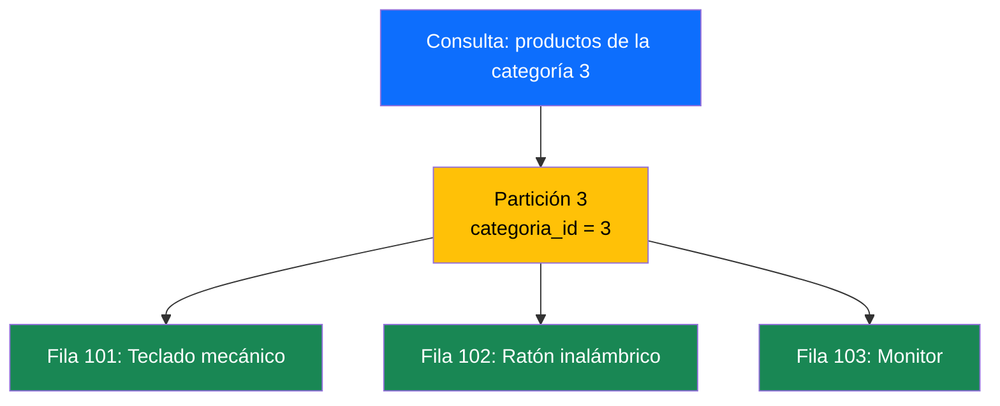
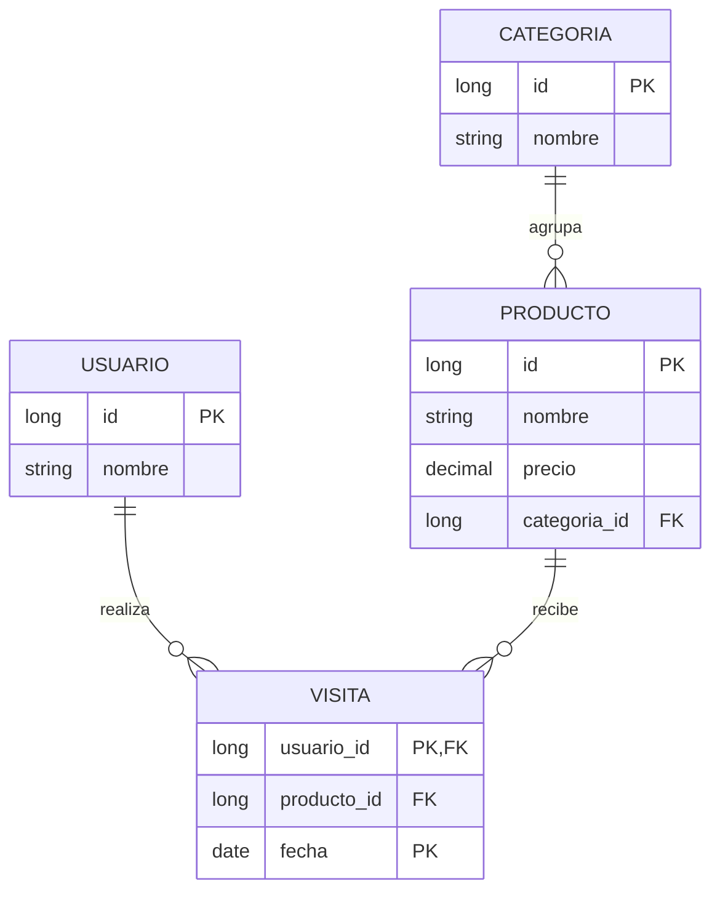
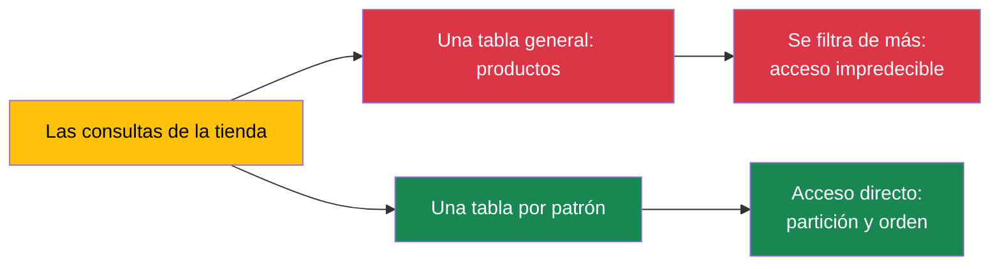
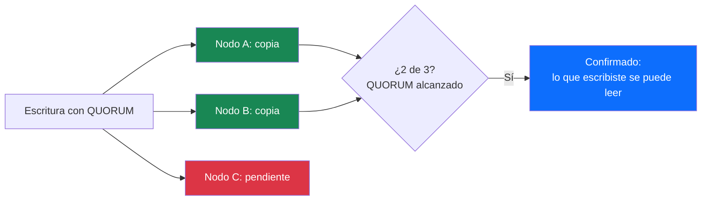

Todo el mundo te enseñó a modelar igual: miras los datos que guardas, dibujas las entidades, cruzas las líneas en un diagrama entidad-relación y de ahí salen las tablas. Las consultas llegan después, a arreglar lo que falte.

Hay sistemas donde ese orden se invierte, y no por capricho: la pregunta ya se conoce de antemano. Qué mensajes tiene el canal 42, qué compró el cliente 17, qué vio el usuario ayer. Si sabes exactamente qué te van a preguntar, ¿para qué diseñar para lo impredecible?

Ahí es donde entra Cassandra.

<!-- more -->

## ¿Qué es Cassandra?

Cassandra guarda **filas de columnas ancho** (*wide-column*): cada fila lleva sus propias columnas —no hace falta que se parezcan a las de la de al lado— y las filas que comparten clave viven juntas en una **partición**. Ojo con la palabra «columnas»: no es la base de datos de columnas analítica de los almacenes de datos (*data warehouse*), que apilan métricas para sacar promedios; esta es una base de datos de operaciones, que se lee y se escribe fila a fila.

Dos rasgos la definen desde el primer minuto: **no tiene primario** —cada nodo acepta lecturas y escrituras; no hay un jefe del que dependa todo— y **está distribuida de fábrica**: nacida para vivir en varios centros de datos a la vez, que es lo que Netflix necesita para servir a medio mundo en milisegundos.

| | SQL (MariaDB) | MongoDB | Cassandra |
|---|---|---|---|
| Unidad | Tabla de filas | Colección de documentos | Tabla de filas de columnas |
| El diseño empieza en | Entidades y relaciones | La forma de los documentos | Las consultas que harás |
| Entre datos | Claves ajenas y `JOIN` | Embeber o referenciar | Duplicar por diseño |
| Consultas | Cualquiera | Cualquiera con índice | Solo las diseñadas |
| Ante un fallo | Primario y réplicas | Primario y réplicas | Todos los nodos iguales |
| Transacciones | ACID | Multi-documento | Dentro de una partición |

Y trampa de la forma: CQL se parece a SQL — `SELECT`, `INSERT`, `CREATE TABLE`, hasta `WHERE` —, y esa semejanza es la parte peligrosa, porque la física de debajo no tiene nada que ver.

## La bandeja de entrada que no dejaba de crecer

Cassandra nació en 2008 en Facebook, de una necesidad muy concreta: la bandeja de entrada que no dejaba de crecer. Para escribir a ese ritmo no valía lo que había, y en lugar de inventar de cero se apoyó en dos papeles que ya circulaban: *Dynamo*, de Amazon, con su distribución sin jefe y su consistencia que tú eliges; y *BigTable*, de Google, con su tabla repartida en disco por claves. Cassandra es el hijo de los dos desde el primer día.

Se cuenta que el nombre viene de la profetisa griega que veía el futuro y a la que nadie hacía caso.

Ese mismo año Facebook lo publicó; en 2009 entró en el incubador de Apache y en febrero de 2010 se convirtió en proyecto de primer nivel. Ya con gente seria detrás: lo que importa no es de dónde viene, es lo que obliga a hacer.

## La fila ancha: partition key y clustering key

CQL se parece a SQL a primera vista. La diferencia está en que la `PRIMARY KEY` de aquí no es una decisión, son dos escondidas en una:

- **Partition key** (`categoria_id`): decide **dónde vive el dato** y qué lectura sale barata. Todo lo de una categoría cae en la misma partición: leerla entera es una llamada a un solo nodo, no importa cuántos tengas.
- **Clustering key** (`producto_id`): decide **el orden dentro de la partición**. Los productos salen ordenados de serie, sin un solo `ORDER BY`; y si quieres orden temporal, se pide al crear la tabla: `WITH CLUSTERING ORDER BY (fecha DESC)`.

```sql
CREATE TABLE productos_por_categoria (
    categoria_id      bigint,
    producto_id       bigint,
    nombre            text,
    precio            decimal,
    categoria_nombre  text,   -- denormalizado: el nombre viaja en cada fila
    PRIMARY KEY (categoria_id, producto_id)
);

INSERT INTO productos_por_categoria (categoria_id, producto_id, nombre, precio, categoria_nombre)
VALUES (3, 101, 'Teclado mecánico', 89.99, 'Periféricos');

-- Los productos de la categoría 3: una sola partición, ordenada de serie
SELECT * FROM productos_por_categoria WHERE categoria_id = 3;
```

La lectura se ve así:



La partición es la unidad de reparto — y también la unidad de problema: si todos los caminos del mundo van a la partición 3, trabajas con un nodo y los demás miran. De ahí el paso siguiente.

## Primero la consulta, después la tabla

El diseño empieza en una pizarra, no en un modelador de entidades. Y para ver qué cambia, mejor con el modelo de siempre: el entidad-relación de la tienda, tal como lo dibujarías en cualquier proyecto SQL.



Lo de siempre: entidades, claves ajenas por todas partes y consultas que se resuelven con un `JOIN` al vuelo. Aquí el orden se invierte — primero describes la consulta en lenguaje natural, respondes las cinco preguntas de más abajo y solo entonces escribes la `PRIMARY KEY`. De ahí sale la tabla, con el nombre de su pregunta encima:

| La pregunta | Patrón de acceso | Tabla que la atiende |
|---|---|---|
| Productos de una categoría | Categoría + orden por producto | `productos_por_categoria` |
| Detalle de un producto | Id suelto | `productos_por_id` |
| Histórico de precios de un producto | Producto + orden temporal | `historial_precios_por_producto` |
| Qué precios cambiaron hoy | El día como clave, con techo | `cambios_precio_por_fecha` |
| Los últimos productos que vio un usuario | Usuario + orden temporal con tope | `vistas_por_usuario` |

Si por el nombre de la tabla no adivinas qué pregunta responde, la tabla está mal presentada y probablemente mal pensada.

Y antes del primer `CREATE TABLE`, cinco preguntas contestadas en este orden:

- ¿Qué valores conoce la aplicación cuando lanza la consulta?
- ¿Qué valor debería llevarnos directamente a una partición?
- ¿Necesitamos orden o un rango dentro de esa partición?
- ¿Puede repetirse una fila? Si puede, ¿qué atributo completa la unicidad?
- ¿Puede crecer esa partición sin techo?



El error opuesto lo conoce todo el mundo: una sola tabla general y mil filtros encima, confiando en que el motor arreglará el desorden. Si dos consultas comparten localización y orden, comparten tabla; si no, cada patrón tiene la suya — ni una por cada `SELECT`, ni todas en una.

Y la diferencia de fondo, la que no sale en la sintaxis: en SQL, el planificador del SGBD decide **en cada consulta** cómo llegar a los datos — qué índice usa, en qué orden cruza, con estadísticas de por medio—. En Cassandra esa decisión ya está tomada antes, en la `PRIMARY KEY`: el camino lo has construido tú y la consulta solo puede recorrerlo. El motor sigue decidiendo a qué nodo ir — ahí manda el hash de la clave—; lo que ya no decide es cómo se lee el dato. **La traducción, al final, no es de sintaxis sino de responsabilidad: en SQL el motor decide en cada consulta; en Cassandra lo decides tú una vez, en el modelo.**

## Se escribe de más para leer de menos

Cassandra no tiene `JOIN`s como mecanismo habitual de consulta, así que la misma información se guarda en varias tablas, una por cada patrón. Es la continuación de lo que vimos en [MongoDB](/posts/2026/2026-10-28-mongodb-sin-esquema-fijo.html) con el embeber —desnormalizar aquí es embeber—, con dos diferencias: no hay techo de 16 MB por documento, y la organización no la decide el tamaño del documento, sino la `partition key` que tú diseñas.

La frase para recordar: **en Cassandra se paga de memoria lo que en un relacional se paga en tiempo de consulta**.

Una visita de producto en su forma más simple — un momento de negocio, dos escrituras:

```sql
CREATE TABLE vistas_por_usuario (
    usuario_id  bigint,
    fecha       timestamp,
    producto_id bigint,
    nombre      text,   -- denormalizado: el feed se pinta sin JOIN
    PRIMARY KEY (usuario_id, fecha)
) WITH CLUSTERING ORDER BY (fecha DESC);

CREATE TABLE vistas_por_dia (
    fecha_dia   date,   -- el día manda: la partición tiene techo
    fecha       timestamp,
    usuario_id  bigint,
    producto_id bigint,
    PRIMARY KEY (fecha_dia, fecha, usuario_id)
);

INSERT INTO vistas_por_usuario (usuario_id, fecha, producto_id, nombre)
VALUES (42, '2026-11-09T10:07:00Z', 101, 'Teclado mecánico');
INSERT INTO vistas_por_dia (fecha_dia, fecha, usuario_id, producto_id)
VALUES ('2026-11-09', '2026-11-09T10:07:00Z', 42, 101);
```

Una visita, dos escrituras y ninguna clave ajena que obligue a que estén al día: **la aplicación es quien mantiene las copias**. Existen los `BATCH`, pero solo dentro de una misma partición son atómicos de verdad; entre tablas distintas, la responsabilidad es tuya.

## La partición que no tiene techo

La partición es la unidad de reparto y también la de crecimiento, y casi nadie se hace la pregunta a tiempo: **¿puede crecer esta partición sin techo?** El histórico de precios de un producto vendido durante años no lo tiene: millones de filas apuntando a la misma partición y un solo nodo tragándoselas.

La solución es trocear: **bucketing**. Discord mete unos diez días de mensajes en cada cubo — comprobando que así ningún cubo pasaba de 100 MB — con esta clave compuesta:

```sql
-- Discord: cubos de unos 10 días, por debajo de los 100 MB
CREATE TABLE messages (
    channel_id bigint,
    bucket     bigint,
    message_id bigint,
    content    text,
    PRIMARY KEY ((channel_id, bucket), message_id)
);
```

Para leer lo reciente generas los cubos que tocan y los recorres en orden. En la tienda, la misma idea con el día: `fecha_dia` como partition key pone techo al histórico y al informe de cambios, que deja de tocar el clúster entero.

::: warning
¿Puede crecer esa partición sin techo? Si no te haces esa pregunta antes del primer `INSERT`, te la hará el gráfico de latencias en producción. Y recuerda: en Cassandra casi todos los problemas de rendimiento son problemas de diseño de tablas, no de hardware — revisa la `PRIMARY KEY` antes de culpar al nodo.
:::

## ALLOW FILTERING: la señal de alarma

«Todos los productos con precio mayor que 50» no es una consulta de Cassandra: no lleva a ninguna partición, recorrería el clúster entero y necesitaría `ALLOW FILTERING` para sobrevivir. No es una solución: es la señal de que la consulta y el diseño no encajan.

::: tip
Si una consulta necesita `ALLOW FILTERING` para funcionar, el problema casi nunca está en la consulta: está en el diseño de la tabla que la atiende. Para preguntas ad-hoc hay opciones mejores — MongoDB con sus índices secundarios o un SQL de toda la vida.
:::

Y algo que sí trae de fábrica y es de agradecer: **TTL nativo por fila**. Un `INSERT ... USING TTL 86400` caduca el dato solo, sin cron ni trabajos de limpieza programados — el mismo oficio que en Redis hacía `EXPIRE` y en Mongo el índice TTL, aquí dentro del propio `INSERT`. Ideal para sesiones, tokens y todo lo que ya sabes que va a caducar.

## Discord: cuando borrar es más caro que escribir

Discord empezó, como tantas aplicaciones, en MongoDB: a principios de 2015, toda la aplicación en una sola réplica, a propósito, para iterar rápido y con el plan escrito de cambiar de base de datos cuando llegara el momento. El momento llegó en noviembre de 2015: 100 millones de mensajes y ni los datos ni el índice cabían en RAM. La latencia dejó de ser predecible.

Lo que pedían era una lista razonable: escala lineal añadiendo nodos sin reparticionar, tolerancia a nodos caídos sin tocar la aplicación, mantenimiento bajo — eran cuatro ingenieros de backend, sin equipo de operaciones — y algo ya probado a escala. Cassandra cumplía todo.

| Cuándo | Qué pasó |
|---|---|
| Mayo de 2015 | Discord nace entero en una sola réplica de MongoDB |
| Noviembre de 2015 | 100 M de mensajes: ni datos ni índice caben en RAM |
| Inicios de 2017 | Migración a Cassandra: base principal en una semana, 12 nodos y tres copias |
| Enero de 2017 | 120 M de mensajes al día, escrituras por debajo de 1 ms y lecturas por debajo de 5 |
| Medio año después | Un canal público borra millones de mensajes: millones de *tombstones* y pausas del recolector de 10 segundos |
| 2022 | 177 nodos y billones de mensajes; migran a ScyllaDB, con 72 |

La migración salió redonda, y el bucketing del apartado anterior es suyo. La sorpresa llegó medio año después, cuando **borrar resultó más caro que escribir**: en Cassandra, borrar no borra, escribe una **marca de borrado** (*tombstone*), un aviso que el motor tiene que ir saltándose en cada lectura hasta que la compactación lo elimina. Un servidor público de Discord borró millones de mensajes por API dejando uno solo; cargar ese canal, que «no tenía» casi nada, obligaba a recorrerlos todos. Pausas de diez segundos y un canal que tardaba veinte en abrirse. Dos arreglos: las *tombstones* pasaron de vivir diez días a dos, y el motor empezó a recordar qué cubos estaban vacíos.

Y el final, que es el más honesto: Cassandra funcionó cinco años, pero la factura de operación —compactaciones, reparaciones, latencias impredecibles— creció con el clúster. En 2022 migraron los mensajes a ScyllaDB, compatible con CQL y sin recolector de basura, de 177 nodos a 72. La lección no es que Cassandra falle: es que a esta escala todo sistema cobra su factura de operación.

## Replicación y consistencia afinable

En [MongoDB](/posts/2026/2026-10-28-mongodb-sin-esquema-fijo.html) montamos un replica set: un primario, sus secundarios y una elección si cae el primero. Aquí no hay primario. Todos los nodos son iguales, se hablan por el protocolo *gossip*, y cualquiera puede recibir tu petición — el que la reciba se encarga de coordinarla con los demás.

Cuántas copias existen lo decide el factor de replicación (RF), y se fija por centro de datos: en mis prácticas, `{'class': 'NetworkTopologyStrategy', 'dc1': 3}` — tres copias en el centro `dc1`. Cuántas copias consultas en cada operación lo eliges tú, operación a operación:

| Nivel | Qué pide | Cuándo |
|---|---|---|
| `ONE` | Una sola copia | Lo más rápido; puedes leer un valor viejo |
| `QUORUM` | La mayoría de las copias | El equilibrio — el de casi todos los días |
| `ALL` | Todas las copias | Máximo control; un nodo caído frena tus escrituras |
| `LOCAL_QUORUM` | La mayoría de tu centro | Multi-centro de datos sin cruzar el océano |

La regla que lo resume: **lecturas + escrituras > copias**. Con tres copias, dos de cada: lo que escribes con `QUORUM` lo lees con `QUORUM` y no hay forma de que te devuelvan el valor anterior. Baja a `ONE` y juegas a la consistencia eventual: escribes y durante un rato alguien puede ver el valor anterior, que a veces es exactamente lo que quieres.



Y lo que no cambia con tanta libertad: sigue sin haber un punto único de fallo. Si cae un nodo, quedan copias — eso es lo que Netflix aprecia cuando su clúster cruza regiones enteras.

## Cassandra en la vida real

Los tres números salen de la propia Apache, del anuncio de la versión 4.0:

| Compañía | Escala desplegada |
|---|---|
| **Apple** | Más de 160.000 instancias, más de 100 PB y más de 1.000 clústeres |
| **Netflix** | Más de 10.000 instancias, 6 PB, más de 100 clústeres y más de 1 billón de peticiones al día |
| **Huawei** | Más de 30.000 instancias repartidas en más de 300 clústeres |

Apple tiene, de lo que es público, el mayor despliegue de Cassandra del mundo. Netflix apoya en él cuentas, facturación, recomendaciones y suscripciones, con los petabytes accesibles en milisegundos. Y detrás de las tres cifras, la idea del principio: ni un solo primario del que depender.

## Cassandra en .NET

Cassandra no tiene su Entity Framework, y no hace falta inventar uno: el driver oficial es de DataStax y vive en el paquete `CassandraCSharpDriver` — actualizado hace dos meses, v3.23.0. El patrón es el mismo que vimos con la colección tipada de MongoDB: un modelo con sus claves a la vista.

```csharp
using Cassandra;
using Cassandra.Mapping;
using Cassandra.Mapping.Attributes;

// El modelo, con sus dos claves declaradas
[Table("productos_por_categoria")]
public class ProductoPorCategoria
{
    [PartitionKey] public long CategoriaId { get; set; }
    [ClusteringKey] public long ProductoId { get; set; }
    public string Nombre { get; set; } = string.Empty;
    public decimal Precio { get; set; }
    public string CategoriaNombre { get; set; } = string.Empty;
}

// Un clúster, una sesión — y a trabajar
var cluster = Cluster.Builder()
    .AddContactPoint("127.0.0.1")
    .Build();
var session = cluster.Connect("tienda");

// Escritura: se prepara una vez, se enlaza en cada llamada
var insert = session.Prepare(
    "INSERT INTO productos_por_categoria (categoria_id, producto_id, nombre, precio, categoria_nombre) VALUES (?, ?, ?, ?, ?)");
await session.ExecuteAsync(insert.Bind(3L, 101L, "Teclado mecánico", 89.99m, "Periféricos"));

// Lectura tipada con el Mapper
var mapper = new Mapper(session);
var productos = await mapper.FetchAsync<ProductoPorCategoria>(
    Cql.New("SELECT * FROM productos_por_categoria WHERE categoria_id = ?", 3L));
```

El `Prepare` guarda el plan de ejecución y el `Bind` rellena los `?` por posición — el orden del CQL es el orden de los parámetros. El `Mapper` devuelve objetos tipados en vez de filas sueltas; si prefieres el enfoque fluido (`Map<T>().PartitionKey(...)`), también está.

Lo que no traerá: ni migraciones —el esquema se crea y cambia con CQL—, ni la comodidad de un LINQ de EF para consultas enrevesadas; el LINQ del driver existe, pero lo que se usa de verdad son sentencias preparadas. Y una honestidad: el driver no arregla el diseño. Si tu tabla está mal pensada, el mejor driver del mundo solo te devolverá el error más rápido.

La tienda de los artículos anteriores no corre sobre Cassandra —sus réplicas siguen en PostgreSQL y MongoDB—; el salto, consulta a consulta y tabla a tabla, está desarrollado paso a paso en [mis apuntes de la UD02](https://github.com/joseluisgs/2DAW-DesarrolloWebServidor).

## ¿Cuándo usar Cassandra y cuándo no?

**Usa Cassandra cuando:**
- Las escrituras son un torrente que no puedes planificar
- Las consultas están conocidas de antemano: los patrones de acceso los escribes antes que las tablas
- Quieres alta disponibilidad sin punto único ni primario
- Tus datos son históricos o por tiempo: mensajes, actividad de usuario, métricas, eventos
- Vives en varios centros de datos y quieres servir desde cada uno
- Te vale el TTL nativo para lo temporal

**No uses Cassandra cuando:**
- Necesitas consultas ad-hoc — «precio mayor que 50» es de MongoDB o de SQL
- Tu modelo vive de cruces y relaciones entre entidades
- Los datos son pocos: un PostgreSQL te sobra, y no te cobra en operación
- Las escrituras cambian datos repartidos en muchas tablas y no quieres que tu aplicación mantenga las copias
- Tu equipo no puede pagar la operación — Discord lo hizo con cuatro ingenieros, pero con años de herramientas propias a cuestas

Cassandra cobra en diseño y en operación, y a cambio te da algo que ninguna de las anteriores: que ningún nodo sea el más importante.

## Docker: Cassandra en un momento

```yaml
# docker-compose.yml
services:
  cassandra:
    image: cassandra:5.0
    ports:
      - "9042:9042"
    volumes:
      - cassandra-data:/var/lib/cassandra
volumes:
  cassandra-data:
```

```bash
docker compose up -d
# Espera un par de minutos: Cassandra arranca despacio, y es normal
docker compose exec cassandra cqlsh
```

Y desde dentro, el keyspace de siempre para empezar a jugar:

```sql
cqlsh> CREATE KEYSPACE IF NOT EXISTS tienda
   ... WITH replication = {'class': 'SimpleStrategy', 'replication_factor': 1};
cqlsh> USE tienda;
cqlsh> DESCRIBE CLUSTER;
```

::: tip
En mis prácticas de la T5 monto un clúster de tres nodos en local, con el heap fijado nodo a nodo — si no, cada contenedor se lleva una parte grande de la RAM que ves y los tres no caben. En producción, otra cosa: NetworkTopologyStrategy por centro de datos y la consistencia pensada desde el primer día, no parcheada después.
:::

## Reflexión

Si te quedas con una frase: en Cassandra el modelo no se dibuja mirando los datos, se dibuja mirando las preguntas. Todo lo demás — particiones, duplicación, bucketing, consistencia — son consecuencias de esa primera decisión.

En [Redis](/posts/2026/2026-08-17-redis-base-datos-clave-valor.html) vimos la caché que va delante de la base de datos; en [CQRS](/posts/2026/2026-09-30-cqrs-mito-moda-realidad.html), cómo separar lo que lee de lo que escribe; en [MongoDB](/posts/2026/2026-10-28-mongodb-sin-esquema-fijo.html), por qué los datos pueden vivir sin esquema fijo; hoy, en Cassandra, la inversión más radical: que el diseño empiece por la pregunta. Cuatro ventanas, la misma pregunta de siempre: dónde viven tus datos y por qué.

Y para clase: con un contenedor y una tarde montas un nodo; con las prácticas, un clúster de tres. Apple llegó a 160.000 — pero todo clúster de 160.000 nodos empezó por una `CREATE TABLE`.

*¿Has modelado alguna vez empezando por las consultas? ¿Te ha sorprendido un ALLOW FILTERING en producción? Cuéntamelo en los comentarios.*
